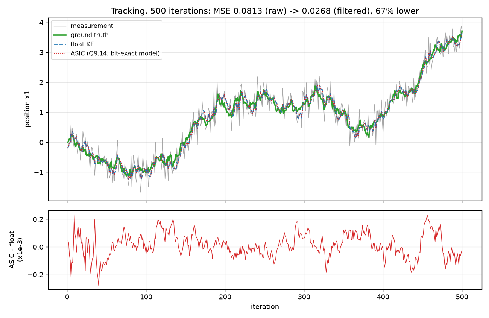

# Kalman Filter ASIC

A two-state Kalman filter processor based on the architecture of
Chávez-Bracamontes et al., *"VLSI architecture of a Kalman filter optimized
for real-time applications"*, IEICE Electronics Express 13(6), 2016
([doi:10.1587/elex.13.20160043](https://doi.org/10.1587/elex.13.20160043)),
designed, verified and implemented down to GDS with open-source tools only,
on the **IHP SG13G2** 130 nm open PDK.

> [!NOTE]
> This is a from-scratch redo of a course project.  The original TSMC 65 nm /
> Cadence version is preserved unchanged in the `legacy-tsmc65` branch;
> [docs/legacy-audit.md](docs/legacy-audit.md) lists what was wrong with it
> and how this version addresses each point.

## Status

| Stage | Tools | Result |
|---|---|---|
| Microcode | `kfasic.asm` (this repo) | 47 instructions, **49 cycles** per filter iteration (original: 188) |
| Lint | Verilator `-Wall`, Yosys `check -assert` | clean, no combinational loops |
| RTL verification | cocotb 2.1 on Icarus Verilog **and** Verilator | bit- and cycle-exact against the golden model; random-program differential tests of the pipeline; bit-exact against the original design's 5000-iteration run |
| RTL → GDS | LibreLane 3.0.17 (Yosys, OpenROAD) | 0.31 mm² macro, **66.7 MHz** |
| Signoff | OpenSTA (3 corners), KLayout + Magic DRC, Netgen LVS | timing met at all corners; DRC, LVS, antenna clean |
| Gate-level simulation | cocotb + Icarus on the routed netlist | the same black-box tests pass |
| Power | OpenSTA with simulated activity | **2.2 nJ per iteration**, 0.36 mW idle |

## The filter

Discrete-time model x_k = Φx_{k-1} + Gu_{k-1} + w, y_k = Hx_k + v with two
states, one measurement and one control input.  One iteration is

```text
x- = Φ x + G u              P- = Φ P Φᵀ + Q
K  = P- Hᵀ (H P- Hᵀ + R)⁻¹
x+ = x- + K (y − H x-)      P+ = (I − K H) P-
```

All of Φ, G, u, H, Q and R are run-time parameters in the data bank, so any
2-state/1-measurement system can be filtered without changing the hardware.



*Constant-velocity tracking (the original project's test case): the
hardware's 24-bit fixed-point result stays within a few LSB (≤ 3·10⁻⁴) of a
double-precision filter.  Produced by `python -m kfasic.plot`, using the
golden model that the RTL matches bit for bit.*

## Architecture

A microcoded multiply-accumulate machine derived from the paper's design.
A sequencer reads a 256 × 21 ROM, with no fetch cycle and no instruction
register. A 32 × 24-bit register file holds the state, the parameters and
temporaries. The datapath is a three-stage pipeline:

1. read two operands;
2. multiply, or add/subtract;
3. accumulate and write back.

A separate radix-8 unit computes 1/S in 8 cycles while the pipeline keeps
working.  Numbers are 24-bit sign-magnitude Q9.14, as in the paper.

The microcode uses the symmetry of the covariance matrices and evaluates
P⁺ = P⁻ − K(P⁻Hᵀ)ᵀ.  In exact arithmetic this is identical to the textbook
equations, and it needs 49 cycles per iteration instead of 188.

Every register group is clock-gated: one gate per register-file entry, and
gates for the operand registers, the result and accumulator registers, the
reciprocal unit and the control.  The multiplier and the adder have separate
operand registers, so only the unit in use sees new data.

The host writes parameters and each new measurement while `ready` is high,
pulses `start`, and reads the updated state back when `ready` returns.
Details, the instruction set and the assembly syntax are in
[docs/architecture.md](docs/architecture.md).

## Verification

The normative model is Python: `kfasic/fixed.py` defines the arithmetic bit
for bit and `kfasic/iss.py` models the pipeline cycle for cycle.

* `tests/` (pure Python, ~1 s):
  * arithmetic properties, and the reciprocal against a bit-serial radix-8 model;
  * assembler encodings and errors;
  * hand-derived pipeline timings;
  * the microcode run in exact arithmetic against the textbook equations on random systems;
  * all 5000 outputs of the original design reproduced bit for bit (`tests/data/`).
* `tb/` (cocotb):
  * the multiplier, adder and reciprocal units against the model;
  * the whole chip as a black box through its pins: register readback,
    tracking, random systems (also compared with a floating-point filter),
    host traffic while busy, reset in mid-run;
  * **random programs**: random instruction streams with dense hazards and
    reciprocal-unit conflicts, run on the RTL and on the model, with every
    register and the cycle count compared.

  Inputs change on the falling clock edge, and the tests pass on both Icarus
  and Verilator, so they do not depend on simulator event ordering.
* The same black-box tests run on the final gate-level netlist (`make gls`).

## Physical implementation (IHP SG13G2)

Hardened as a standalone macro (no pad ring) with LibreLane 3.0.17: Yosys
0.62, OpenROAD/OpenSTA (2026-02), Magic 8.3.623, KLayout 0.30.7 and Netgen
1.5.316, on the IHP SG13G2 PDK as pinned by LibreLane.  The clock gates map to
the PDK's integrated clock-gating cell `sg13g2_lgcp_1`.  Configuration and
constraints: [`flow/ihp-sg13g2/`](flow/ihp-sg13g2/).

| Metric | Value |
|---|---|
| Clock | 15 ns (66.7 MHz) |
| Die | 0.306 mm², 52.6 % core utilization |
| Cells | 24,322 including fill, decap and tap cells; 148,142 µm² |
| Setup / hold WNS, slow 1.08 V / 125 °C | +1.87 / +0.60 ns |
| Setup / hold WNS, typical 1.20 V / 25 °C | +5.72 / +0.29 ns |
| Setup / hold WNS, fast 1.32 V / −40 °C | +7.78 / +0.11 ns |
| Max slew / max capacitance violations | 0 / 0 |
| Routing DRC, Magic DRC, KLayout DRC | 0, 0, 0 |
| LVS (Netgen) | clean |
| Antenna violations | 0 |
| Magic vs KLayout GDS (XOR) | identical |
| Worst IR drop | 1.2 mV |
| Throughput | 50 cycles per iteration (START to READY) → 1.33 M iterations/s |

Timing includes ±5 % derate and 0.25 ns clock uncertainty and is signed off
at all three corners (the IHP default checks setup only at typical).
`make summary` regenerates this table from a run.

For comparison, the paper's chip (0.5 µm, 3 metal layers) ran at up to
20 MHz in 5.6 mm² and needed 113 cycles per iteration.

## Power

`flow/power.py` replays a workload on the routed netlist (Icarus, zero
delay), records the switching activity and has OpenSTA compute power with
the extracted parasitics, at the typical corner.  It does not include glitch
power.  The first open-source version (single-cycle datapath, 188-cycle
microcode, no clock gating; commit `5330f70`) was measured the same way.

| | first version | current |
|---|---|---|
| Clock | 50 MHz | 66.7 MHz |
| Cycles per iteration (incl. host write of y) | 191 | 53 |
| Power while filtering | 4.35 mW | 2.72 mW |
| **Energy per iteration** | **16.6 nJ** | **2.17 nJ** (7.7× less) |
| Idle power (clock running) | 3.13 mW | 0.36 mW (8.6× less) |
| Leakage | 8.6 µW | 9.4 µW |

## Quick start

Tools: Python ≥ 3.10 with a shared `libpython` (uv-managed Pythons have one),
Icarus Verilog and/or Verilator, Yosys (e.g. [OSS CAD Suite](https://github.com/YosysHQ/oss-cad-suite-build)),
and for the physical flow [LibreLane](https://github.com/librelane/librelane)
(its AppImage needs no root; extract it with `--appimage-extract` if FUSE is
unavailable).  LibreLane downloads the PDK by itself.

```sh
make venv                 # .venv with kfasic, cocotb, numpy (uses uv)
make lint
make test                 # model, unit, chip and random-program tests; SIM=verilator also works
make test-long            # 5000-iteration RTL regression
LL=$HOME/tools/librelane/squashfs-root/AppRun
make flow LIBRELANE="$LL -- librelane"
make summary              # signoff table
make gls                  # gate-level simulation of the final netlist
make power STA="$LL -- sta"
```

Changing the program: edit `fw/kf_2d.s`, then `make rom` regenerates
`rtl/kf_rom.v` (a test fails if the committed ROM is stale).

## Repository layout

```text
rtl/        Verilog: kf_top, kf_rom (generated), kf_regfile, kf_mul, kf_addsub, kf_rcp, kf_clkgate
fw/         microcode (assembly source)
kfasic/     Python: fixed-point model, assembler, ISS, random programs, reference filter, plots
tests/      fast model tests (pytest)
tb/         cocotb testbenches, the pytest runner, the power-analysis testbench
flow/       LibreLane configuration (flow/ihp-sg13g2), signoff summary, power analysis
docs/       architecture, audit of the course version, images
```
