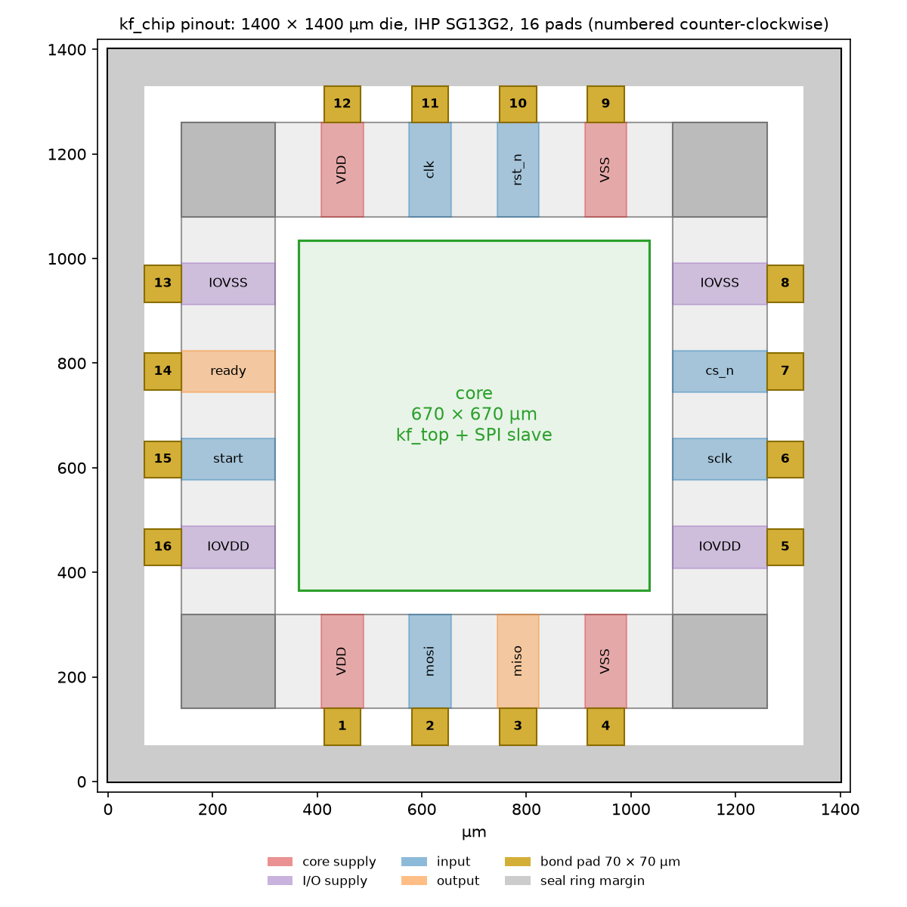
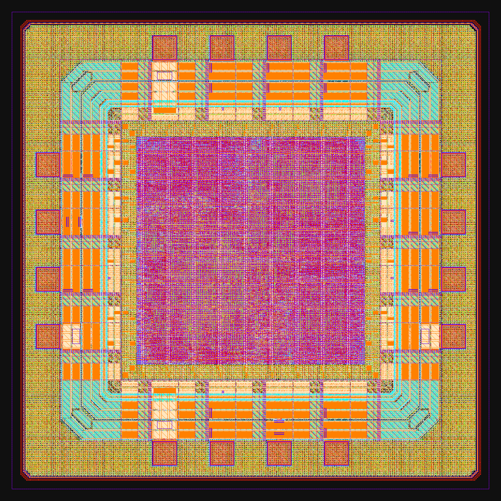
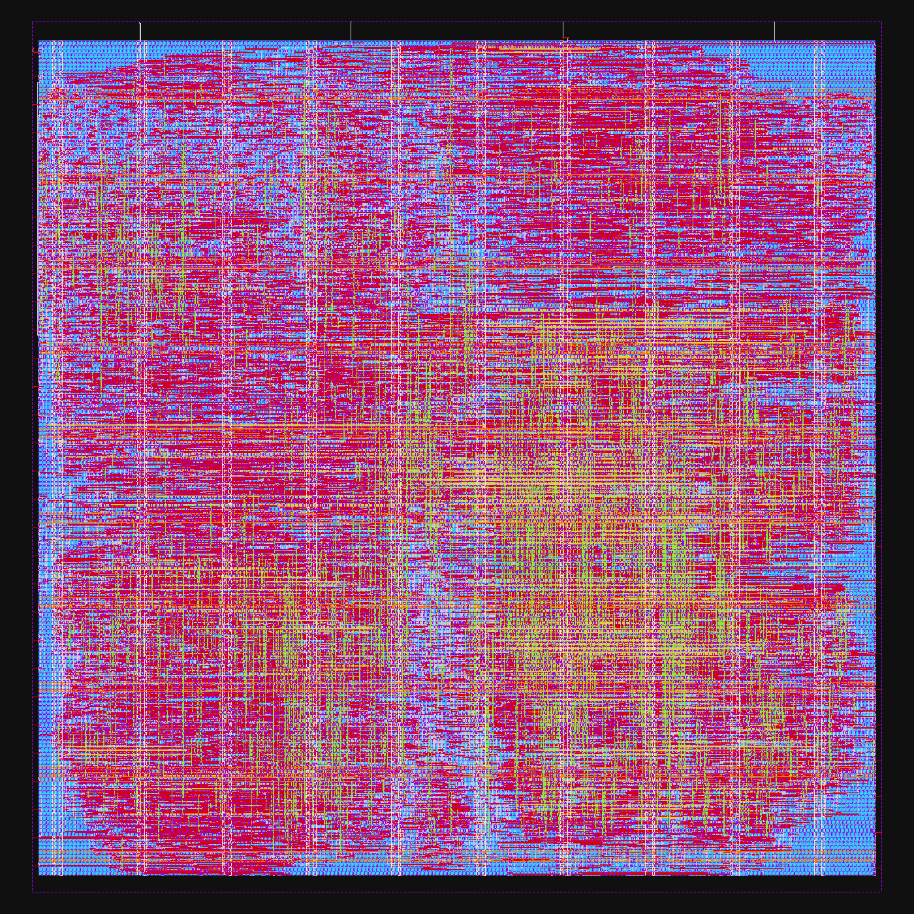

# Kalman Filter ASIC

A two-state Kalman filter processor based on the architecture of
Chávez-Bracamontes et al., *"VLSI architecture of a Kalman filter optimized
for real-time applications"*, IEICE Electronics Express 13(6), 2016
([doi:10.1587/elex.13.20160043](https://doi.org/10.1587/elex.13.20160043)),
designed, verified and implemented down to a complete chip — pad ring, seal
ring, fill — with open-source tools only, on the **IHP SG13G2** 130 nm open
PDK.

> [!NOTE]
> This is a from-scratch redo of a course project.  The original TSMC 65 nm /
> Cadence version is preserved unchanged in the `legacy-tsmc65` branch;
> [docs/legacy-audit.md](docs/legacy-audit.md) lists what was wrong with it
> and how this version addresses each point, and
> [docs/comparison.md](docs/comparison.md) compares the paper, the course
> design and every generation of this redo.

## Status

| Stage | Tools | Result |
|---|---|---|
| Microcode | `kfasic.asm` (this repo) | 22 dot-product instructions, **25 cycles** per filter iteration from START to READY (paper: 113, course design: ~196) |
| Lint | Verilator `-Wall`, Yosys `check -assert` | clean, no combinational loops |
| RTL verification | cocotb 2.1 on Icarus Verilog **and** Verilator | bit- and cycle-exact against the golden model; random-program differential tests of the pipeline; the chip through its pads (SPI); bit-exact against the original design's 5000-iteration run |
| Core RTL → GDS | LibreLane 3.0.17 (Yosys, OpenROAD) | 0.59 mm² macro, **125 MHz** at the slow corner (1.08 V, 125 °C), 204 MHz typical: **0.20 µs per iteration** |
| Chip | LibreLane Chip flow | 1.4 mm × 1.4 mm die: 16 IHP I/O pads, SPI host interface, seal ring, metal and active fill |
| Signoff | OpenSTA (3 corners), Magic and KLayout DRC, IHP's full DRC deck, Netgen LVS, IHP's KLayout LVS deck, a pad-ring short check on the full layout, GDS XOR, PDNSim IR drop with the supply at the pads | timing, slew and capacitance met at every corner; DRC, LVS, antenna, density clean; waived, with reasons in [docs/chip.md](docs/chip.md#verification-and-signoff): one recommended pad rule, and Magic's overlap reports at the I/O cells' abstract views |
| Equivalence | Yosys + ABC `dprove` | the routed netlists of the core and of the chip are sequentially equivalent to the RTL |
| Gate-level simulation | cocotb + Icarus | the black-box tests pass on the routed core and chip netlists, with typical- and fast-corner SDF delays at 125 MHz |
| Power | OpenSTA with SDF-annotated simulated activity | **2.07 nJ per iteration** (glitches included), 0.21 mW idle |

## The filter

Discrete-time model x_k = Φx_{k-1} + Gu_{k-1} + w, y_k = Hx_k + v with two
states, one measurement and one control input.  One iteration is

```text
x- = Φ x + G u              P- = Φ P Φᵀ + Q
K  = P- Hᵀ (H P- Hᵀ + R)⁻¹
x+ = x- + K (y − H x-)      P+ = (I − K H) P-
```

All of Φ, G, u, H, Q and R are run-time parameters in the data bank, so any
2-state/1-measurement system can be filtered without changing the hardware.


*Constant-velocity tracking (the original project's test case): the
hardware's 24-bit fixed-point result stays within a few LSB (≤ 3·10⁻⁴) of a
double-precision filter.  Produced by `python -m kfasic.plot`, using the
golden model that the RTL matches bit for bit.*

## Architecture

A microcoded dot-product machine derived from the paper's design.  The
filter's arithmetic is almost entirely two-term dot products, so every
instruction is one:

```text
ACC <- base ± A·B ± D·E        base = 0, ACC or a register
```

with an optional register write and an optional start of the reciprocal
unit.  A and D may also be 1/S or the constant 1.0.  Two 23 × 23 Booth
multipliers (Wallace tree, Kogge-Stone adder) work in parallel in a
three-stage pipeline:

1. read the four factors from a 32 × 24-bit register file (Booth-recoding
   B and E on the way into the operand registers);
2. multiply, and read the base;
3. add the base and both products exactly, saturate once, write back.

Results are forwarded from the last stage, so an instruction only waits if
a factor is the result of the instruction just before it.  A radix-8 unit
computes 1/S, two digits per cycle, in 4 cycles while the pipeline keeps
working.  Numbers are 24-bit sign-magnitude Q9.14, as in the paper.

Every matrix element of ΦP, P⁻, P⁻Hᵀ, S, x⁻ and the innovation is one
instruction; the covariance update uses the symmetry of P and Q and
evaluates P⁺ = P⁻ − K(P⁻Hᵀ)ᵀ (identical in exact arithmetic).  The order of
the 22 instructions was found by a branch-and-bound search with the
cycle-accurate model as the cost function: 24 cycles, the minimum for the
dependency chain ΦP → P⁻ → P⁻Hᵀ → S → 1/S → K → P⁺, plus one cycle for the
host input register.

For low power, every register group is clock-gated (one gate per
register-file entry; gates for the operand, product, base, accumulator,
reciprocal and control registers; the second multiplier's operands load
only for two-product instructions) behind a core clock gate that stops the
clock while idle.  The register-file read ports decode their address one-hot,
the instruction register keeps the ROM's glitches out of them, and the
assembler encodes unused fields and the order of commutative operands so
that as few bits as possible change from one instruction to the next.

The host writes parameters and each new measurement while `ready` is high,
pulses `start`, and reads the updated state back when `ready` returns.
Details, the instruction set and the assembly syntax are in
[docs/architecture.md](docs/architecture.md).

## The chip

`kf_chip` puts the core behind an SPI slave (mode 0, 32-bit frames: write,
read, start, continuous runs) and IHP's `sg13g2_io` pads: 6 inputs (clock,
reset, SCLK, CS_N, MOSI, START), 2 outputs (MISO, tristate; READY), and two
pairs each of core (1.2 V) and I/O (3.3 V) supply pads, on a
1.4 mm × 1.4 mm die with 70 µm bond pads, a seal ring and fill.  Pinout,
protocol, floorplan and test plan: [docs/chip.md](docs/chip.md).

<p> </p>

*Left: pinout and bonding diagram (`make pinout`).  Right: the final chip
GDS (`make render`).*

## Verification

The normative model is Python: `kfasic/fixed.py` defines the arithmetic bit
for bit and `kfasic/iss.py` models the pipeline cycle for cycle.

* `tests/` (pure Python, ~2 s):
  * arithmetic properties: products, the exact three-term sum, the
    reciprocal against a bit-serial radix-8 model;
  * assembler encodings, errors and the low-toggle re-encoding;
  * hand-derived pipeline timings;
  * the microcode run in exact arithmetic against the textbook equations on
    random systems;
  * all 5000 outputs of the original design reproduced bit for bit
    (`tests/data/`).
* `tb/` (cocotb):
  * the Booth multiplier, the accumulation adder and the reciprocal unit
    against the model;
  * the core as a black box through its pins: register readback, tracking,
    random systems (also compared with a floating-point filter), host
    traffic while busy, reset in mid-run;
  * **random programs**: random instruction streams with dense hazards and
    reciprocal-unit conflicts, run on the RTL and on the model, with every
    register and the cycle count compared;
  * the chip through its pads, with an SPI master: readback, tracking,
    the START pin and its latency, continuous mode, malformed frames,
    requests while busy.

  Inputs change on the falling clock edge, and the tests pass on both Icarus
  and Verilator, so they do not depend on simulator event ordering.
* The same black-box tests run on the final gate-level netlists of the core
  (`make gls`) and of the chip (`make chip-gls`), also back-annotated with
  the typical- and fast-corner delays at the design's clock period
  (`SDF=1`, `SDF_CORNER=...`), which exercises the clock gating, resets,
  hold paths and pads with real timing.
* **Logic equivalence** (`make lec`, `make chip-lec`): the routed netlist is
  proven sequentially equivalent to the RTL with Yosys and ABC's `dprove`
  (register correspondence, SAT sweeping, induction).  Clock gates are
  rewritten as clock enables on both sides and the I/O cells are cut out as
  black boxes, as in commercial LEC.  The proof takes about 30 s; a netlist
  with one gate changed is rejected with a counterexample.
* The cell-level register-file read port used in the IHP flow is proven
  equal to its RTL with a SAT miter (`make equiv`).

## Physical implementation

Hardened with LibreLane 3.0.17: Yosys 0.62, OpenROAD/OpenSTA (2026-02),
Magic 8.3.623, KLayout 0.30.7 and Netgen 1.5.316, on the IHP SG13G2 PDK as
pinned by LibreLane.  The clock gates map to the PDK's integrated
clock-gating cell `sg13g2_lgcp_1`.  The multipliers and adders are written
out as structures (Booth recoding, Wallace tree, Kogge-Stone), which
synthesis keeps; its own multiplier was 1.1 ns slower in isolation.
Placement-stage timing repair uses the RC of the layers signals are
actually routed on (the LibreLane default averages in the thick top
metals, which made it work against a 1.4 ns too optimistic estimate).
Configuration and constraints: [`flow/ihp-sg13g2/`](flow/ihp-sg13g2/)
(core) and [`flow/chip/`](flow/chip/).

| Metric | Core macro | Chip |
|---|---|---|
| Clock | 8.0 ns (125 MHz) | 8.0 ns (125 MHz) |
| Area | 759 µm × 777 µm = 0.59 mm² | 1.4 mm × 1.4 mm = 1.96 mm², 16 pads |
| Standard cells | 23,159 (256,578 µm², 46 % utilization) | 23,651 (268,669 µm², 60 % of the 670 µm × 670 µm core area) + 16 I/O cells |
| Setup / hold WNS, slow 1.08 V / 125 °C | +0.36 / +0.30 ns | +0.23 / +0.56 ns |
| Setup / hold WNS, typical 1.20 V / 25 °C | +3.11 / +0.16 ns | +3.03 / +0.25 ns |
| Setup / hold WNS, fast 1.32 V / −40 °C | +4.38 / +0.01 ns | +4.66 / +0.08 ns |
| Max slew / max capacitance / max fanout violations | 0 / 0 / 4: 3 clock-tree root buffers (fanout 16, built by CTS), 1 data net (fanout 9) | 0 / 0 / 6: 4 clock-tree root buffers (fanout 16, built by CTS), 2 data nets (fanout 14 and 9) |
| Routing DRC, Magic DRC, KLayout DRC (flow) | 0, 0, 0 | 0, 0, 0 |
| IHP DRC deck, full rule set incl. density and antenna | — | clean except the recommended rule `Pad.fR` (I/O cell design, see [chip.md](docs/chip.md#verification-and-signoff)); density and antenna clean |
| LVS | Netgen: clean; IHP KLayout deck (transistor level): clean | Netgen: clean |
| Pad ring on the full layout: shorts, opens, I/O cell pins | — | clean (`make chip-shorts`) |
| Antenna violations | 0 | 0 (OpenROAD and KLayout) |
| Magic vs KLayout GDS (XOR) | identical | identical |
| Static IR drop, every net switching 20 % per cycle (`make ir`, `make chip-ir`) | VPWR 16.6 mV, VGND 4.5 mV (19 mW; PDNSim's default supply over the top metal: the integration decides) | VDD 11.1 mV, VSS 6.6 mV (21 mW; supply at the pads' straps) |
| Logic equivalence to the RTL | proven | proven |
| Throughput | 25 cycles per iteration → 5.0 M iterations/s | SPI-bound: a WRITE_START and two READ frames per sample (f_SCLK ≤ f_CLK / 10) |

Timing includes ±5 % derate and 0.25 ns clock uncertainty and is signed off
at all three corners (the IHP default checks setup only at typical).  The
write-back stage — the exact three-term sum, saturation and its fan-out to
the register file, forwarding and the reciprocal unit — sets the period;
at 8.0 ns the core keeps 0.36 ns of slack at the slow corner, the chip
0.23 ns.  Besides the asynchronous reset and the chip's synchronized
inputs, the constraints contain two exceptions: hold checks from the
register file to the operand registers are waived (forwarding guarantees
that an operand register never captures a register on the edge that
writes it; gate-level simulation with fast-corner delays confirms it),
and the MISO pad's enable arcs are not timed (they follow CS_N, which
changes only between SPI frames).  `make summary` and `make chip-summary`
regenerate the flow numbers from a run.



*The core macro, rendered from its final GDS with KLayout
(`flow/render_gds.py`).*

The chip's final GDS, with seal ring and fill, also passes IHP's complete
KLayout DRC deck (`make chip-drc`: FEOL and BEOL rules, pads, seal ring,
density, antenna and the extra rule set, recommended rules off as in
LibreLane's IHP flow) except `Pad.fR`, a recommended rule that the deck's
pad table checks anyway and that the IHP I/O cells cannot meet.  Around
the pad ring, where the flow's LVS sees the I/O cells only as abstracts,
`make chip-shorts` checks the full layout for shorts and opens.  The
waivers, the constraint exceptions and why the chip's LVS is Netgen's are
listed in [docs/chip.md](docs/chip.md#verification-and-signoff).

## Power

`flow/power.py` replays a workload on the routed netlist, back-annotated
with the typical-corner SDF delays so that the recorded switching activity
includes glitches, and has OpenSTA compute power with the extracted
parasitics at the typical corner.  (Zero-delay activity, `--zero-delay`,
misses the glitches.)  Every version below is measured this way: the first
open-source version (single-cycle datapath, 188-cycle microcode, no clock
gating; commit `5330f70`), the first pipelined version (`2160277`), the
fused multiply-add version (`fcb3833`) and the current one.

| | first version | pipelined | fused multiply-add | **current** |
|---|---|---|---|---|
| Clock | 50 MHz | 66.7 MHz | 121 MHz | 125 MHz |
| Cycles per iteration (incl. host write of y) | 191 | 53 | 41 | 27 |
| Power while filtering | 6.61 mW | 3.65 mW | 5.82 mW | 9.57 mW |
| **Energy per iteration** | **25.3 nJ** | **2.90 nJ** | **1.97 nJ** | **2.07 nJ** |
| Idle power (clock running) | 3.13 mW | 0.36 mW | 0.17 mW | 0.21 mW |
| Leakage | 8.6 µW | 9.4 µW | 11.0 µW | 19.5 µW |

Where the 2.07 nJ of an iteration go (`make power`, which attributes each
cell to a block by the registers in its fan-in cone):

| Block | pJ | Share |
|---|---|---|
| Multipliers | 487 | 24 % |
| Accumulate (WB adder) | 483 | 23 % |
| Flip-flops | 434 | 21 % |
| Clock trees and clock gates | 233 | 11 % |
| Reciprocal unit | 175 | 8 % |
| ROM, decode, register reads | 137 | 7 % |
| Write-back, forwarding, data-in multiplexers | 96 | 5 % |
| Hold-fix delay cells, control, fill, I/O | 23 | 1 % |

The current version finishes an iteration 1.6× sooner than the fused
multiply-add version for about the same energy (+5 %).  Executing 22
instead of 36 instructions saves instruction fetches, register reads and
operand loads, but the exact three-term addition (a 35-bit carry-save and
compound Kogge-Stone adder: 23 % of the energy, against 9 % for the
two-input adder before) and the reciprocal unit's two digits per cycle
spend it again.  Energy × latency is 35 % lower.  Of the 0.21 mW idle
power, 148 µW is the clock network that keeps running while idle and
20 µW leakage of the 1.7× larger core.

## Quick start

Tools: Python ≥ 3.10 with a shared `libpython` (uv-managed Pythons have one),
Icarus Verilog and/or Verilator, Yosys and yosys-abc (e.g. [OSS CAD
Suite](https://github.com/YosysHQ/oss-cad-suite-build)), and for the
physical flows and signoff [LibreLane](https://github.com/librelane/librelane)
(its AppImage needs no root; extract it with `--appimage-extract` if FUSE is
unavailable).  LibreLane downloads the PDK by itself; the IHP decks are
taken from it.

```sh
make venv                 # .venv with kfasic, cocotb, numpy (uses uv)
make lint
make test                 # model, unit, chip and random-program tests; SIM=verilator also works
make test-long            # 5000-iteration RTL regression
export LL="$HOME/tools/librelane/squashfs-root/AppRun --"   # how to start LibreLane's tools
make flow LL="$LL"        # the core macro
make summary
make gls                  # gate-level simulation (SDF=1: with delays, SDF_CORNER=...)
make lec                  # netlist vs. RTL equivalence
make lvs LL="$LL"         # IHP KLayout LVS deck on the core
make ir LL="$LL"          # static IR drop of the core, every net switching 20 %
make equiv                # cell-level read port vs. RTL
make power LL="$LL"
make chip LL="$LL"        # the whole die
make chip-summary chip-gls chip-lec
make chip-drc LL="$LL"    # IHP's full DRC deck on the chip GDS
make chip-shorts LL="$LL" # shorts and opens around the pad ring, full layout
make chip-ir LL="$LL"     # static IR drop, supply at the pads
make pinout render LL="$LL"
```

Changing the program: edit `fw/kf_2d.s`, then `make rom` regenerates
`rtl/kf_rom.v` (a test fails if the committed ROM is stale).

## Repository layout

```text
rtl/        Verilog: kf_chip (pads), kf_spi, kf_top (core), kf_rom (generated), kf_regfile,
            kf_rdport, kf_booth, kf_mul, kf_dot, kf_rcp, kf_add, kf_prefix, kf_clkgate
fw/         microcode (assembly source)
kfasic/     Python: fixed-point model, assembler, ISS, random programs, reference filter, plots
tests/      fast model tests (pytest)
tb/         cocotb testbenches, the pytest runner, the power-analysis testbench
flow/       LibreLane configurations (ihp-sg13g2: core, chip: die), signoff scripts
            (summary, LEC, LVS, pad-ring check, IR drop, power, pinout, rendering)
docs/       architecture, the chip, comparison with the paper and the course design,
            audit of the course version, images
```
