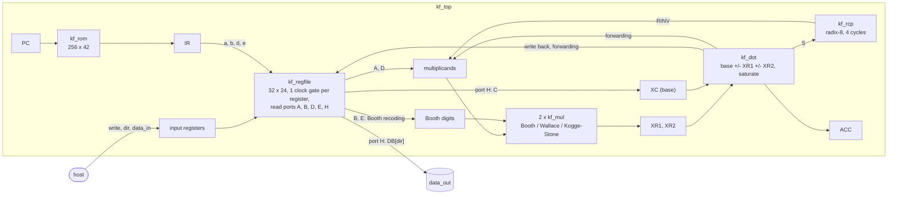

# Architecture

The design starts from Fig. 3 of R. Chávez-Bracamontes, M. A. Gurrola-Navarro,
H. J. Jiménez-Flores and M. Bandala-Sánchez, "VLSI architecture of a Kalman
filter optimized for real-time applications", *IEICE Electronics Express*
13(6), 2016, [doi:10.1587/elex.13.20160043](https://doi.org/10.1587/elex.13.20160043):
a small microcoded processor whose only operations are add/subtract,
multiply and reciprocal, configured for n = 2 states, r = 1 measurement and
m = 1 control input.  The paper executes one operation per cycle on a
single-cycle datapath.  Here every instruction is a **two-term dot product
with an addend** on two multipliers, in a three-stage pipeline with
forwarding, and the reciprocal is computed in the background: one filter
iteration takes 25 cycles from START to READY instead of 113.  Aggressive
clock gating removes almost all idle power.  How this compares with the
paper and the course design, generation by generation, is in
[comparison.md](comparison.md); the chip around the core is described in
[chip.md](chip.md).



| Block | File | Notes |
|---|---|---|
| Top level, pipeline control | `rtl/kf_top.v` | host interface, instruction register, decode, interlocks, forwarding, operand/result registers |
| Microcode ROM | `rtl/kf_rom.v` | hard-wired logic generated from `fw/kf_2d.s` by `kfasic.asm` |
| Data bank | `rtl/kf_regfile.v` | 32 × 24 flip-flops, one write and five asynchronous read ports (A, B, D, E for the factors, H for the base and the host), one clock gate per register |
| Read port | `rtl/kf_rdport.v` | one-hot address decode and AND-OR; built from AOI22/NAND2/NOR2/OR2 cells in the IHP flow (`flow/ihp-sg13g2/kf_rdport_ihp.v`, proven equal by `make equiv`) |
| Booth recoding | `rtl/kf_booth.v` | radix-4 digits of the multiplier operands, computed before the operand registers |
| Multiplier | `rtl/kf_mul.v` | 23 × 23 magnitudes, truncated to 32 bits: Booth partial products, Wallace tree, Kogge-Stone adder |
| Accumulation | `rtl/kf_dot.v` | base ± p1 ± p2: carry-save level, compound Kogge-Stone adder, sign, saturation |
| Reciprocal unit | `rtl/kf_rcp.v` | 1/S by radix-8 restoring division, two digits per cycle, 4 cycles, runs alongside the datapath |
| Adders | `rtl/kf_prefix.v`, `rtl/kf_add.v` | Kogge-Stone carry network used by all of the above |
| Clock gate | `rtl/kf_clkgate.v` | latch-based behavioral model; `sg13g2_lgcp_1` in the physical flow |

## Number format

24-bit sign-magnitude fixed point, Q9.14: bit 23 is the sign, bits 22..0 the
magnitude with 9 integer and 14 fractional bits (range ±511.99994, resolution
2⁻¹⁴ ≈ 6.1·10⁻⁵).  This is the paper's choice (9 integer bits cover a 360°
rotation; 14 fractional bits are a margin over the 9 the paper found
necessary).

Each product is truncated to 14 fractional bits (rounded toward zero) but
not saturated; the sum of an instruction's base and products is formed
exactly and saturated once to the largest magnitude, and a zero result is
always +0.  Whenever no partial sum overflows this equals a chain of the
paper's saturating multiply and add operations, so the program reproduces
the course design's results bit for bit.  The reciprocal is exact:
RINV = floor(2²⁸ / |S|) with the sign of S, saturated for |S| ≤ 32 LSB
(|S| < 2⁻⁹), so R·RINV equals the paper's division R/S with
|error| ≤ (|R|+1) LSB.  `kfasic/fixed.py` is the normative definition and the
RTL is tested against it bit for bit.

## Pipeline

| Stage | Work |
|---|---|
| F | `ROM[PC]` is loaded into the instruction register IR (overlapped with S1) |
| S1 | IR is decoded; the factors A and D (a register, RINV or the constant 1.0) and B and E (registers) are read; B and E are Booth recoded; everything goes into the operand registers |
| EX | A·B and D·E → XR1, XR2; the base (register C through port H, or ACC, or 0) → XC, and whether each product is subtracted from its magnitude |
| WB | ACC ← sat(XC ± XR1 ± XR2); optionally also written to register `dst`; optionally the reciprocal unit is started with the result |

The instruction register is loaded on every issue and holds on a stall; PC
returns to 0 when a run ends, so the edge that starts a run already loads
`ROM[0]` and fetching costs no cycle.

The result in WB is forwarded to the operand reads of the same cycle: to
the four factors in S1 and to the base in EX.  S1 therefore stalls
(inserting a bubble) only when

* it reads a register as a factor that the instruction in EX will write,
  for one cycle;
* it reads RINV while an instruction that starts the reciprocal unit is in
  EX or WB, or the unit is busy and not in its last cycle;
* it starts the reciprocal unit while another such instruction is in EX or
  WB or the unit is busy.

The base never stalls: it is read one stage later, when its producer has
reached WB.  ACC as the base is the result of the instruction just ahead
(forwarded if it is in WB).  Port H is addressed straight from a register:
the host address register, which during a run takes the base field of the
instruction entering EX, so neither the host read path to `data_out` nor
the base read has a multiplexer in front of the decoder.

The reciprocal unit takes the result of the instruction that starts it,
together with its multiples 3|S|, 5|S| and 7|S|, at the end of that
instruction's WB cycle, then computes two radix-8 quotient digits per cycle
for four cycles while the pipeline keeps executing other instructions.  In
its last cycle the new RINV is already on its output and is forwarded to
an instruction that reads it, so 1/S is available to the instruction issued
six cycles after the one that computes S.

HALT ends the run once no reciprocal is pending.  The instruction that is
in EX at that point commits one cycle after the run, while READY is already
1: the host's first read or write cannot reach the register file before it.
The interlocks make every program correct; the microcode is scheduled so
that they rarely fire.  `kfasic/iss.py` models all of this cycle for cycle,
and random programs are run on the RTL and the model to check that they
agree.

## Instruction set

42-bit word (the ROM is synthesized logic, so its width costs little):

| Bits | Field | Meaning |
|---|---|---|
| 41..40 | op | 0 NOP, 1 HALT, 2 ALU, 3 ALU and start the reciprocal unit |
| 39..38 | base | 0 zero, 1 ACC, 2 register `c` |
| 37 | n1 | subtract A·B |
| 36 | m2 | the second product D·E is present |
| 35 | n2 | subtract D·E |
| 34 | wr | also write the result to register `dst` |
| 33..29 | dst | destination register |
| 28..24 | a | factor A register |
| 23..22 | asrc | A is register `a` (0), RINV (1) or the constant 1.0 (2) |
| 21..17 | b | factor B register |
| 16..12 | d | factor D register |
| 11..10 | dsrc | D is register `d`, RINV or 1.0 |
| 9..5 | e | factor E register |
| 4..0 | c | base register |

Every arithmetic instruction is

```text
ACC <- base +/- A*B [+/- D*E]          base = 0, ACC or register c
```

with an optional register write and an optional start of the reciprocal
unit.  Additions, subtractions and copies are expressed with the constant
1.0 (A·1.0 is exact).

Assembly syntax (`fw/*.s`, assembled by `python -m kfasic.asm`):

```text
.reg  phi11  6                       ; name a register
a11  = phi11*p11 + phi12*p12         ; dot product, result in a11 (and ACC)
p11  = q11 + a11*phi11 + a12*phi12   ; with an addend
acc  = phi11*x1 + phi12*x2           ; result in ACC only
x1m  = acc + g1*u                    ; ACC as the base
inn  = y - h1*x1m - h2*x2m           ; subtracting
s    = r11 + h1*pht1 + h2*pht2, rcp  ; also RINV <- 1/s in the background
k1   = pht1*rinv                     ; RINV as a factor
d    = x - y                         ; bare registers: x - y*1.0
halt
```

The assembler also re-encodes each program for low switching activity
without changing its behavior (`kfasic.asm.reduce_toggles`): fields an
instruction does not use repeat the previous instruction's values, and the
factors of a product and the two products are exchanged where that keeps a
register read on consecutive cycles on the same port or leaves a
multiplier's operands unchanged.

## The microcode

`fw/kf_2d.s` evaluates

```text
A   = Φ P                   P- = A Φᵀ + Q
PHt = P- Hᵀ                 S  = H PHt + R          RINV = 1/S
x-  = Φ x + G u             ν  = y − H x-
K   = PHt · RINV            x+ = x- + K ν           P+ = P- − K PHtᵀ
```

P and Q are covariance matrices, so only their upper triangles are used
(`p21`, `q21` are ignored) and P⁺ is formed as P⁻ − K(P⁻Hᵀ)ᵀ, which reuses
P⁻Hᵀ from the gain instead of computing (I − KH)P⁻.  In exact arithmetic
this is identical to the textbook equations (`tests/test_model.py` checks
it to 10⁻¹² on random systems).  Every matrix element is one instruction:
22 in all.

The order was found by a branch-and-bound search over all orders that
respect the data dependencies, with the cycle-accurate model as the cost
function.  The dependency chain A → P⁻ → P⁻Hᵀ → S → 1/S → K → P⁺ sets the
length: S issues in cycle 10, 1/S is available to the instruction issued
in cycle 16, and seven instructions need it.  x⁻ and the innovation fill
the gap.

| | Cycles |
|---|---|
| 22 instructions issued, one stall (the innovation waits for x⁻) | 23 |
| HALT: ends the run while the last instruction is in EX | 1 |
| **Program** | **24** |
| host input register (START) | 1 |
| **START to READY** | **25** |

The original microcode needed 188 cycles (196 in the course version).

## Host interface

All signals are synchronous to `clk`. `rst_n` is asserted asynchronously and
released through a two-flop synchronizer.  The host inputs are registered
once inside `kf_top`; there are no input-to-output combinational paths.

| Pin | Dir | Meaning |
|---|---|---|
| `clk`, `rst_n` | in | clock, active-low reset |
| `start` | in | one-cycle pulse: run the program from PC 0 |
| `write` | in | `DB[dir] <= data_in` |
| `dir[4:0]` | in | register address for host writes and reads |
| `data_in[23:0]` | in | write data |
| `ready` | out | 1 when idle: two cycles after reset is released, and after HALT |
| `data_out[23:0]` | out | `DB[dir]`, read combinationally from the registered address: valid by the end of the cycle after `dir` is presented while `ready` = 1 (the chip's SPI slave registers it on the next edge); 0 while busy |

A request (`start` or `write`) is accepted only if `ready` = 1 in the cycle
it is presented; anything presented while `ready` = 0 is ignored.  `ready`
drops on the clock edge that captures `start` and rises again 25 cycles
later.  In the chip, an SPI slave drives this interface
([chip.md](chip.md)).

Using the filter:

1. After reset, write the parameters: x, P, Φ, Q, H, R, G, u (registers 0–19,
   see `fw/kf_2d.s`; P and Q symmetric).
2. For every sample: write `y` to register 20, pulse `start`, wait for
   `ready`, read back x (registers 0–1) and, if wanted, P (2, 3, 5).

## Low-power design

Simulation-based analysis of the first version showed that 92 % of the
power went into flip-flops and the clock tree, because every flip-flop was
clocked every cycle while at most one register changes per cycle, and that
idle power was 72 % of active power.  The design therefore:

* puts a core clock gate in front of everything except the host input
  registers: it opens only for a run, the commit of its last instruction or
  a host write, so while idle the clock stops there and the gates below it
  and their clock trees do not toggle;
* gives every register-file entry its own clock gate (32 gates instead of
  768 enable multiplexers);
* gates every other register group by its use: the operands of each
  multiplier (the second one only for two-product instructions), the
  products, the base, ACC, the instruction register, the reciprocal unit,
  the host data register, and the sequencer/pipeline control;
* executes few instructions: 22 dot products per iteration instead of 36
  multiply-adds (v3) or 188 single operations;
* decodes the register-file read addresses one-hot and AND-ORs the
  registers: a new address toggles the select lines of the old and the new
  register only;
* loads the instruction into a register, so the ROM's glitches do not reach
  the decode logic and the read ports;
* encodes the microcode for few toggles (see above);
* forces `data_out` to 0 while busy, so the outputs do not toggle during a
  run.

While idle only the reset synchronizer, the host input registers and the
core clock gate are clocked.  `flow/power.py` measures power from simulated
activity, with back-annotated delays, on the routed netlist (see the README
for the numbers).
