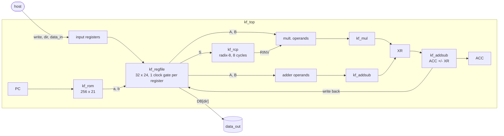

# Architecture

The design starts from Fig. 3 of R. Chávez-Bracamontes, M. A. Gurrola-Navarro,
H. J. Jiménez-Flores and M. Bandala-Sánchez, "VLSI architecture of a Kalman
filter optimized for real-time applications", *IEICE Electronics Express*
13(6), 2016, [doi:10.1587/elex.13.20160043](https://doi.org/10.1587/elex.13.20160043):
a small microcoded processor whose only operations are add/subtract,
multiply and reciprocal, configured for n = 2 states, r = 1 measurement and
m = 1 control input.  The paper's single-cycle datapath with a 16-bit
instruction word is reworked here into a pipelined multiply-accumulate
machine with a reciprocal unit that runs in parallel, which cuts one filter
iteration from 188 to 49 cycles and lets the clock run faster; aggressive
clock gating removes almost all idle power.



| Block | File | Notes |
|---|---|---|
| Top level, pipeline control | `rtl/kf_top.v` | host interface, S1 decode and interlocks, operand/result registers |
| Microcode ROM | `rtl/kf_rom.v` | hard-wired logic generated from `fw/kf_2d.s` by `kfasic.asm` |
| Data bank | `rtl/kf_regfile.v` | 32 x 24 flip-flops, one write and two asynchronous read ports, one clock gate per register |
| Multiplier | `rtl/kf_mul.v` | 23 x 23 magnitude product, truncated and saturated (Booth/Wallace in synthesis) |
| Adder/subtractor | `rtl/kf_addsub.v` | used twice: A ± B in EX, ACC ± XR in WB |
| Reciprocal unit | `rtl/kf_rcp.v` | 1/S by radix-8 restoring division, 8 cycles, runs alongside the datapath |
| Clock gate | `rtl/kf_clkgate.v` | latch-based behavioral model; `sg13g2_lgcp_1` in the physical flow |

## Number format

24-bit sign-magnitude fixed point, Q9.14: bit 23 is the sign, bits 22..0 the
magnitude with 9 integer and 14 fractional bits (range ±511.99994, resolution
2⁻¹⁴ ≈ 6.1·10⁻⁵).  This is the paper's choice (9 integer bits cover a 360°
rotation; 14 fractional bits are a margin over the 9 the paper found
necessary).

All operations saturate instead of wrapping and never produce −0.
Multiplication truncates the magnitude.  The reciprocal is exact:
RINV = floor(2²⁸ / |S|) with the sign of S, saturated for |S| ≤ 32 LSB
(|S| < 2⁻⁹), so R·RINV equals the paper's division R/S with
|error| ≤ (|R|+1) LSB.  `kfasic/fixed.py` is the normative definition and the
RTL is tested against it bit for bit.

## Pipeline

| Stage | Work |
|---|---|
| S1 | `ROM[PC]` is decoded; registers A and B (or RINV) are read into the operand registers of the unit the instruction uses |
| EX | multiply, or add / subtract / load → XR |
| WB | ACC ← XR, or ACC ± XR for MAC/MSB; optionally also written to register `dst` |

There is no instruction register and no fetch cycle: the ROM output drives
the register-file read addresses directly, as in the paper.  The reciprocal
unit takes S when an RCP instruction issues and delivers RINV 8 cycles later,
while the pipeline keeps executing other instructions.

S1 stalls (inserting a bubble) when

* it reads a register that the instruction in EX or WB will write
  (read-after-write at distance 1 or 2), or
* it reads RINV, or is an RCP, while the reciprocal unit is busy.

HALT completes once EX and the reciprocal unit are empty; the instruction
in WB commits on that same clock edge.  The interlocks
make every program correct; the microcode is scheduled so that they hardly
ever fire.  `kfasic/iss.py` models this cycle for cycle, and random programs
are run on the RTL and the model to check that they agree.

## Instruction set

21-bit word (the ROM is synthesized logic, so its width costs little):

| Bits | Field | Meaning |
|---|---|---|
| 20..17 | op | 0 NOP, 1 HALT, 2 MUL, 3 MAC, 4 MSB, 5 ADD, 6 SUB, 7 LDA, 8 RCP |
| 16 | wr | also write the new ACC value to register `dst` |
| 15..11 | dst | destination register |
| 10..6 | a | operand A |
| 5..1 | b | operand B |
| 0 | bi | operand B is RINV instead of register `b` |

| Op | Effect |
|---|---|
| MUL | ACC ← A·B |
| MAC | ACC ← ACC + A·B |
| MSB | ACC ← ACC − A·B |
| ADD / SUB | ACC ← A ± B |
| LDA | ACC ← A |
| RCP | RINV ← 1/B (background, 8 cycles) |

Assembly syntax (`fw/*.s`, assembled by `python -m kfasic.asm`):

```text
.reg  phi11  6           ; name a register
mul   acc, phi11, p11    ; ACC <- phi11 * p11
mac   a11, phi12, p12    ; ACC <- ACC + phi12 * p12, and a11 <- ACC
lda   acc, q11           ; ACC <- q11
rcp   s                  ; RINV <- 1/s
mul   k1, pht1, rinv     ; k1 <- pht1 / s
halt
```

## The microcode

`fw/kf_2d.s` evaluates

```text
A   = Φ P                   P- = A Φᵀ + Q
PHt = P- Hᵀ                 S  = H PHt + R          RINV = 1/S
x-  = Φ x + G u             ν  = y − H x-
K   = PHt · RINV            x+ = x- + K ν           P+ = P- − K PHtᵀ
```

P and Q are covariance matrices, so only their upper triangles are used
(`p21`, `q21` are ignored) and P⁺ is formed as P⁻ − K(P⁻Hᵀ)ᵀ, which reuses
P⁻Hᵀ from the gain instead of computing (I − KH)P⁻.  In exact arithmetic
this is identical to the textbook equations (`tests/test_model.py` checks
it to 10⁻¹² on random systems).  The reciprocal is started as soon as S is
known and hidden behind x⁻ and the innovation.

| | Cycles |
|---|---|
| 46 instructions issued (MUL/MAC/MSB/LDA/RCP) | 46 |
| interlock stall (K waits for RINV) | 1 |
| HALT: drain EX; the last instruction commits as the run ends | 2 |
| **Program** | **49** |
| host input register (START) | 1 |
| **START to READY** | **50** |

The original microcode needed 188 cycles (196 in the course version).

## Host interface

All signals are synchronous to `clk`. `rst_n` is asserted asynchronously and
released through a two-flop synchronizer.  The host inputs are registered
once inside `kf_top`; there are no input-to-output combinational paths.

| Pin | Dir | Meaning |
|---|---|---|
| `clk`, `rst_n` | in | clock, active-low reset |
| `start` | in | one-cycle pulse: run the program from PC 0 |
| `write` | in | `DB[dir] <= data_in` |
| `dir[4:0]` | in | register address for host writes and reads |
| `data_in[23:0]` | in | write data |
| `ready` | out | 1 when idle: two cycles after reset is released, and after HALT |
| `data_out[23:0]` | out | `DB[dir]`, valid one cycle after `dir` is presented; 0 while busy |

A request (`start` or `write`) is accepted only if `ready` = 1 in the cycle
it is presented; anything presented while `ready` = 0 is ignored.  `ready`
drops on the clock edge that captures `start` and rises again 50 cycles
later.

Using the filter:

1. After reset, write the parameters: x, P, Φ, Q, H, R, G, u (registers 0–19,
   see `fw/kf_2d.s`; P and Q symmetric).
2. For every sample: write `y` to register 20, pulse `start`, wait for
   `ready`, read back x (registers 0–1) and, if wanted, P (2, 3, 5).

## Low-power design

Simulation-based analysis of the first version showed that 92 % of the
power went into flip-flops and the clock tree, because every flip-flop was
clocked every cycle while at most one register changes per cycle, and that
idle power was 72 % of active power.  The current design therefore:

* puts a core clock gate in front of everything except the host input
  registers: it opens only for a run or a host write, so while idle the
  clock stops there and the 40 gates below it and their clock tree do not
  toggle;
* gives every register-file entry its own clock gate (32 gates instead of
  768 enable multiplexers);
* gates every other register group by its use: multiplier operands, adder
  operands, XR, ACC, the reciprocal unit, the host data register, and the
  sequencer/pipeline control (clocked only while running);
* keeps separate operand registers for the multiplier and the adder, so the
  multiplier sees no new data during add/subtract/load and vice versa;
* computes 1/S with a small radix-8 divider instead of 23 passes through the
  multiplier;
* drives `data_out` combinationally from the register file and forces it to
  0 while busy, so the outputs do not toggle during a run.

While idle only the reset synchronizer, the host input registers and the
core clock gate are clocked.  `flow/power.py` measures power from simulated activity on the
routed netlist (see the README for the numbers).
