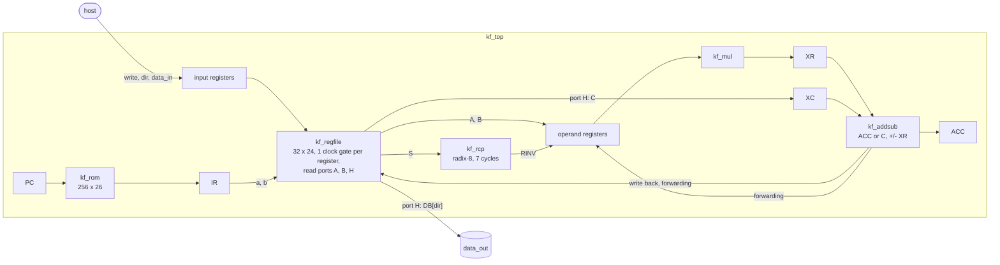

# Architecture

The design starts from Fig. 3 of R. Chávez-Bracamontes, M. A. Gurrola-Navarro,
H. J. Jiménez-Flores and M. Bandala-Sánchez, "VLSI architecture of a Kalman
filter optimized for real-time applications", *IEICE Electronics Express*
13(6), 2016, [doi:10.1587/elex.13.20160043](https://doi.org/10.1587/elex.13.20160043):
a small microcoded processor whose only operations are add/subtract,
multiply and reciprocal, configured for n = 2 states, r = 1 measurement and
m = 1 control input.  The paper's single-cycle datapath with a 16-bit
instruction word is reworked here into a pipelined multiply-accumulate
machine: every instruction is a fused multiply-add, results are forwarded,
and a reciprocal unit runs in parallel.  One filter iteration takes 38
cycles instead of 188, and the clock runs faster; aggressive clock gating
removes almost all idle power.



| Block | File | Notes |
|---|---|---|
| Top level, pipeline control | `rtl/kf_top.v` | host interface, instruction register, decode, interlocks, forwarding, operand/result registers |
| Microcode ROM | `rtl/kf_rom.v` | hard-wired logic generated from `fw/kf_2d.s` by `kfasic.asm` |
| Data bank | `rtl/kf_regfile.v` | 32 x 24 flip-flops, one write and three asynchronous read ports (A, B for operands, H for the addend and the host), one clock gate per register |
| Read port | `rtl/kf_rdport.v` | one-hot address decode and AND-OR; built from AOI22/NAND4/OR4 cells in the IHP flow (`flow/ihp-sg13g2/kf_rdport_ihp.v`, proven equal by `make equiv`) |
| Multiplier | `rtl/kf_mul.v` | 23 x 23 magnitude product, truncated and saturated (Booth/Wallace in synthesis) |
| Adder/subtractor | `rtl/kf_addsub.v` | in WB: ACC ± XR or C ± XR |
| Reciprocal unit | `rtl/kf_rcp.v` | 1/S by radix-8 restoring division, 7 cycles, runs alongside the datapath |
| Clock gate | `rtl/kf_clkgate.v` | latch-based behavioral model; `sg13g2_lgcp_1` in the physical flow |

## Number format

24-bit sign-magnitude fixed point, Q9.14: bit 23 is the sign, bits 22..0 the
magnitude with 9 integer and 14 fractional bits (range ±511.99994, resolution
2⁻¹⁴ ≈ 6.1·10⁻⁵).  This is the paper's choice (9 integer bits cover a 360°
rotation; 14 fractional bits are a margin over the 9 the paper found
necessary).

All operations saturate instead of wrapping and never produce −0.
Multiplication truncates the magnitude.  The reciprocal is exact:
RINV = floor(2²⁸ / |S|) with the sign of S, saturated for |S| ≤ 32 LSB
(|S| < 2⁻⁹), so R·RINV equals the paper's division R/S with
|error| ≤ (|R|+1) LSB.  `kfasic/fixed.py` is the normative definition and the
RTL is tested against it bit for bit.

## Pipeline

| Stage | Work |
|---|---|
| F | `ROM[PC]` is loaded into the instruction register IR (overlapped with S1) |
| S1 | IR is decoded; operand A (a register) and operand B (a register, RINV or the constant 1.0) are read into the multiplier's operand registers |
| EX | A·B → XR; the addend C of MAD/MSD is read through port H → XC |
| WB | ACC ← XR (MUL), ACC ± XR (MAC/MSB) or C ± XR (MAD/MSD); optionally also written to register `dst` |

The instruction register is loaded on every issue and holds on a stall; PC
returns to 0 when a run ends, so the edge that starts a run already loads
`ROM[0]` and fetching costs no cycle.

The result in WB is forwarded to the operand reads of the same cycle: to
A and B in S1 (and the divisor of an RCP) and to C in EX.  S1 therefore
stalls (inserting a bubble) only when

* it reads a register as A or B (or as the divisor of RCP) that the
  instruction in EX will write, for one cycle, or
* it reads RINV, or is an RCP, while the reciprocal unit is busy.

The addend C never stalls: it is read one stage later, when its producer
has reached WB.  The reciprocal unit takes S when an RCP issues and delivers
RINV 7 cycles later while the pipeline keeps executing other instructions;
as the dividend is the constant 2²⁸, the first of the eight radix-8 quotient
digits only compares |S| with constants and is computed while S is loaded.

HALT completes once EX and the reciprocal unit are empty; the instruction
in WB commits on that same clock edge.  The interlocks make every program
correct; the microcode is scheduled so that they do not fire.
`kfasic/iss.py` models all of this cycle for cycle, and random programs are
run on the RTL and the model to check that they agree.

## Instruction set

26-bit word (the ROM is synthesized logic, so its width costs little):

| Bits | Field | Meaning |
|---|---|---|
| 25..23 | op | 0 NOP, 1 HALT, 2 MUL, 3 MAC, 4 MSB, 5 MAD, 6 MSD, 7 RCP |
| 22 | wr | also write the new ACC value to register `dst` |
| 21..17 | dst | destination register |
| 16..12 | a | operand A |
| 11..7 | b | operand B, or the divisor of RCP |
| 6..5 | bs | operand B is register `b` (0), RINV (1) or the constant 1.0 (2) |
| 4..0 | c | addend C of MAD and MSD |

| Op | Effect |
|---|---|
| MUL | ACC ← A·B |
| MAC | ACC ← ACC + A·B |
| MSB | ACC ← ACC − A·B |
| MAD | ACC ← C + A·B |
| MSD | ACC ← C − A·B |
| RCP | RINV ← 1/B (background, 7 cycles) |

Every arithmetic instruction is one multiplication followed by one
accumulation, so there is a single datapath and no separate adder unit.
A·1.0 is exact, so additions, subtractions and loads are pseudo-instructions:

| Pseudo | Assembled as |
|---|---|
| `lda d, X` | `mul d, X, one` (ACC ← X) |
| `add d, X, Y` | `mad d, Y, one, X` (ACC ← X + Y) |
| `sub d, X, Y` | `msd d, Y, one, X` (ACC ← X − Y) |

Assembly syntax (`fw/*.s`, assembled by `python -m kfasic.asm`):

```text
.reg  phi11  6               ; name a register
mul   acc, phi11, p11        ; ACC <- phi11 * p11
mac   a11, phi12, p12        ; ACC <- ACC + phi12 * p12, and a11 <- ACC
mad   acc, a11, phi11, q11   ; ACC <- q11 + a11 * phi11
rcp   s                      ; RINV <- 1/s
mul   k1, pht1, rinv         ; k1 <- pht1 / s
msd   p11, k1, pht1, p11     ; p11 <- p11 - k1 * pht1
halt
```

The assembler also re-encodes each program for low switching activity
without changing its behavior (`kfasic.asm.reduce_toggles`): fields an
instruction does not use repeat the previous instruction's values, and the
operands A and B are exchanged where that keeps a register read on
consecutive cycles on the same port.

## The microcode

`fw/kf_2d.s` evaluates

```text
A   = Φ P                   P- = A Φᵀ + Q
PHt = P- Hᵀ                 S  = H PHt + R          RINV = 1/S
x-  = Φ x + G u             ν  = y − H x-
K   = PHt · RINV            x+ = x- + K ν           P+ = P- − K PHtᵀ
```

P and Q are covariance matrices, so only their upper triangles are used
(`p21`, `q21` are ignored) and P⁺ is formed as P⁻ − K(P⁻Hᵀ)ᵀ, which reuses
P⁻Hᵀ from the gain instead of computing (I − KH)P⁻.  In exact arithmetic
this is identical to the textbook equations (`tests/test_model.py` checks
it to 10⁻¹² on random systems).  MAD/MSD add Q, R, y, x⁻ and P⁻ directly,
so no instruction preloads the accumulator.  The order of the dot products
is chosen so that no instruction waits: P⁻Hᵀ is interleaved with P⁻, and the
reciprocal is started right after S and hidden behind x⁻ and the
innovation.  On the original project's test case the program still
reproduces the course RTL's results bit for bit.

| | Cycles |
|---|---|
| 36 instructions issued (MUL/MAC/MSB/MAD/MSD/RCP), no stall | 36 |
| HALT: drain EX; the last instruction commits as the run ends | 2 |
| **Program** | **38** |
| host input register (START) | 1 |
| **START to READY** | **39** |

The original microcode needed 188 cycles (196 in the course version).

## Host interface

All signals are synchronous to `clk`. `rst_n` is asserted asynchronously and
released through a two-flop synchronizer.  The host inputs are registered
once inside `kf_top`; there are no input-to-output combinational paths.

| Pin | Dir | Meaning |
|---|---|---|
| `clk`, `rst_n` | in | clock, active-low reset |
| `start` | in | one-cycle pulse: run the program from PC 0 |
| `write` | in | `DB[dir] <= data_in` |
| `dir[4:0]` | in | register address for host writes and reads |
| `data_in[23:0]` | in | write data |
| `ready` | out | 1 when idle: two cycles after reset is released, and after HALT |
| `data_out[23:0]` | out | `DB[dir]`, valid one cycle after `dir` is presented; 0 while busy |

A request (`start` or `write`) is accepted only if `ready` = 1 in the cycle
it is presented; anything presented while `ready` = 0 is ignored.  `ready`
drops on the clock edge that captures `start` and rises again 39 cycles
later.

Using the filter:

1. After reset, write the parameters: x, P, Φ, Q, H, R, G, u (registers 0–19,
   see `fw/kf_2d.s`; P and Q symmetric).
2. For every sample: write `y` to register 20, pulse `start`, wait for
   `ready`, read back x (registers 0–1) and, if wanted, P (2, 3, 5).

## Low-power design

Simulation-based analysis of the first version showed that 92 % of the
power went into flip-flops and the clock tree, because every flip-flop was
clocked every cycle while at most one register changes per cycle, and that
idle power was 72 % of active power.  The current design therefore:

* puts a core clock gate in front of everything except the host input
  registers: it opens only for a run or a host write, so while idle the
  clock stops there and the gates below it and their clock trees do not
  toggle;
* gives every register-file entry its own clock gate (32 gates instead of
  768 enable multiplexers);
* gates every other register group by its use: operands, XR, XC, ACC, the
  instruction register, the reciprocal unit, the host data register, and
  the sequencer/pipeline control (clocked only while running);
* executes fewer instructions: fusing the addend into the multiply-add
  removes the ten accumulator loads per iteration, and with them the
  separate adder unit and its operand registers;
* computes 1/S with a small radix-8 divider instead of 23 passes through the
  multiplier;
* decodes the register-file read addresses one-hot and AND-ORs the
  registers: a new address toggles the select lines of the old and the new
  register only, where a binary multiplexer tree toggles select lines that
  reach every bit (fanout 192, buffered);
* loads the instruction into a register, so the ROM's glitches do not reach
  the decode logic and the read ports;
* encodes the microcode for few toggles (see above);
* forces `data_out` to 0 while busy, so the outputs do not toggle during a
  run.

While idle only the reset synchronizer, the host input registers and the
core clock gate are clocked.  `flow/power.py` measures power from simulated
activity, with back-annotated delays, on the routed netlist (see the README
for the numbers).
