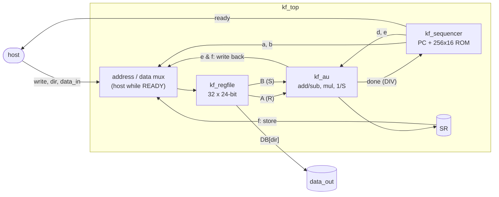

# Architecture

The design follows Fig. 3 of R. Chávez-Bracamontes, M. A. Gurrola-Navarro,
H. J. Jiménez-Flores and M. Bandala-Sánchez, "VLSI architecture of a Kalman
filter optimized for real-time applications", *IEICE Electronics Express*
13(6), 2016, [doi:10.1587/elex.13.20160043](https://doi.org/10.1587/elex.13.20160043):
a minimal microcoded processor whose only operations are add/subtract,
multiply and divide, configured here for n = 2 states, r = 1 measurement and
m = 1 control input.



| Block | File | Notes |
|---|---|---|
| Sequencer | `rtl/kf_sequencer.v` | 8-bit PC, no fetch cycle and no instruction register: the ROM output drives the datapath directly |
| Microcode ROM | `rtl/kf_rom.v` | 256 x 16, hard-wired logic generated from `fw/kf_2d.s` by `kfasic.asm` |
| Data bank | `rtl/kf_regfile.v` | 32 x 24 flip-flops, one write port, two asynchronous read ports, no forwarding |
| Arithmetic unit | `rtl/kf_au.v` | combinational add/sub and multiply; DIV by successive approximation on the same multiplier |
| Top level | `rtl/kf_top.v` | host interface, result register SR, reset synchronizer |

## Number format

24-bit sign-magnitude fixed point, Q9.14: bit 23 is the sign, bits 22..0 the
magnitude with 9 integer and 14 fractional bits (range ±511.99994, resolution
2⁻¹⁴ ≈ 6.1·10⁻⁵).  This is the paper's choice (9 integer bits cover a 360°
rotation; 14 fractional bits are a margin over the 9 the paper found
necessary).

All operations saturate instead of wrapping and never produce −0.
Multiplication truncates the magnitude.  Division computes R·(1/S): the
reciprocal is the largest 23-bit Q with Q·|S| ≤ 1.0, found one bit per cycle,
then multiplied by R, so |error| ≤ (|R|+1) LSB.  1/S saturates for
|S| < 2⁻⁹, which bounds the usable innovation variance S = HPHᵀ + R from below.
`kfasic/fixed.py` is the normative definition; the RTL is tested against it
bit for bit.

## Host interface

All signals are synchronous to `clk`. `rst_n` is asserted asynchronously and
released through a two-flop synchronizer.  The host inputs are registered
once inside `kf_top`, so the block has no input-to-output combinational
paths and its I/O timing is trivial.

| Pin | Dir | Meaning |
|---|---|---|
| `clk`, `rst_n` | in | clock, active-low reset |
| `start` | in | one-cycle pulse: run the program from PC 0 |
| `write` | in | `DB[dir] <= data_in` |
| `dir[4:0]` | in | register address for host writes and reads |
| `data_in[23:0]` | in | write data |
| `ready` | out | 1 when idle: two cycles after reset is released, and after HALT |
| `data_out[23:0]` | out | `DB[dir]`, valid two cycles after `dir` is presented |

A request (`start` or `write`) is accepted only if `ready` = 1 in the cycle
it is presented; anything presented while `ready` = 0 is ignored.  `ready`
drops on the clock edge that captures `start` and rises again 189 cycles
later (one input-register cycle plus 188 program cycles).

```text
clk      _|‾|_|‾|_|‾|_|‾|_|‾|_  ...  _|‾|_|‾|_
start    ___/‾‾‾\______________  ...  _________
ready    ‾‾‾‾‾‾‾\______________  ...  ___/‾‾‾‾‾
              edge 0           ...   edge 189
```

Using the filter:

1. After reset, write all parameters (x, P, Φ, Q, H, R, G, u: registers 0–19,
   see `fw/kf_2d.s`).
2. For every sample: write `y` to register 20, pulse `start`, wait for
   `ready`, read back x (registers 0–1) and, if wanted, P (2–5).  Register
   20 is used as scratch by the program, so `y` must be rewritten for each
   iteration.

## Instruction set

16-bit word, the paper's format `a4..a0 b4..b0 c1 c0 d1 d0 e f`:

| Bits | Field | Meaning |
|---|---|---|
| 15..11 | a | register A: operand R, and the write-back address |
| 10..6 | b | register B: operand S |
| 5..4 | c | 00 next, 01 wait (required on DIV), 10 HALT |
| 3..2 | d | 00 ADD, 01 SUB, 10 MUL, 11 DIV |
| 1 | e | execute: SR ← DB[a] op DB[b] |
| 0 | f | write: DB[a] ← (e ? result : SR) |

ADD, SUB and MUL take one cycle, DIV 25 (setup, 23 bit decisions, final
multiply); the sequencer stalls automatically while a DIV is in progress.
The paper leaves the exact encoding open; this one is the original project's.

Assembly syntax (`fw/*.s`, assembled by `python -m kfasic.asm`):

```text
.reg  phi11  6           ; name a register
mul   sr, phi11, x1      ; SR <- phi11 * x1             (e=1, f=0)
mov   t21, sr            ; t21 <- SR                    (e=0, f=1)
add   t21, t21, t22      ; t21 <- t21 + t22, in place   (e=1, f=1)
div   sr, t27, t29       ; SR <- t27 / t29, 25 cycles   (c=01)
halt
```

Because only register A can be written back, most products need a separate
`mov`; the program has 139 instructions plus HALT and runs in 188 cycles
(the paper reports 113 cycles with its own, unpublished microcode).

## Cycle budget of `fw/kf_2d.s`

| | Cycles |
|---|---|
| 137 one-cycle instructions | 137 |
| 2 DIV (K₁, K₂) | 50 |
| HALT | 1 |
| **Program** | **188** |
| host input register (START) | 1 |
| **START to READY** | **189** |
