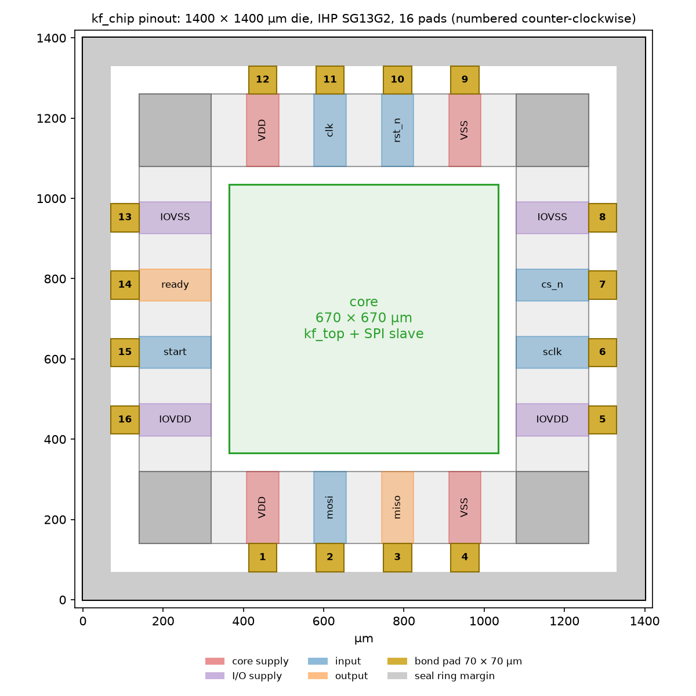

# The chip

`kf_chip` (`rtl/kf_chip.v`) is the tape-out top level: the Kalman filter
core `kf_top`, an SPI slave (`rtl/kf_spi.v`) that drives the core's host
interface, and a ring of 16 IHP `sg13g2_io` pads, implemented flat on a
1.4 mm × 1.4 mm die (`flow/chip/`).

## Pinout



*Generated from the routed DEF by `flow/chip/pinout.py` (`make pinout`).*

Four pads per side; pads are numbered counter-clockwise from the
lower-left corner, as on a bonding diagram.  Bond-pad centers are in µm
from the lower-left corner of the die.

| # | Side | Signal | I/O cell | Direction | Bond pad center (µm) |
|---|---|---|---|---|---|
| 1 | south | VDD (1.2 V core) | `sg13g2_IOPadVdd` | supply | (448, 105) |
| 2 | south | `mosi` | `sg13g2_IOPadIn` | in | (616, 105) |
| 3 | south | `miso` (released while `cs_n` is high) | `sg13g2_IOPadTriOut16mA` | out | (784, 105) |
| 4 | south | VSS | `sg13g2_IOPadVss` | supply | (952, 105) |
| 5 | east | IOVDD (3.3 V I/O) | `sg13g2_IOPadIOVdd` | supply | (1295, 448) |
| 6 | east | `sclk` | `sg13g2_IOPadIn` | in | (1295, 616) |
| 7 | east | `cs_n` | `sg13g2_IOPadIn` | in | (1295, 784) |
| 8 | east | IOVSS | `sg13g2_IOPadIOVss` | supply | (1295, 952) |
| 9 | north | VSS | `sg13g2_IOPadVss` | supply | (952, 1295) |
| 10 | north | `rst_n` (active low, asynchronous) | `sg13g2_IOPadIn` | in | (784, 1295) |
| 11 | north | `clk` | `sg13g2_IOPadIn` | in | (616, 1295) |
| 12 | north | VDD | `sg13g2_IOPadVdd` | supply | (448, 1295) |
| 13 | west | IOVSS | `sg13g2_IOPadIOVss` | supply | (105, 952) |
| 14 | west | `ready` (high while the core is idle) | `sg13g2_IOPadOut16mA` | out | (105, 784) |
| 15 | west | `start` (rising edge starts an iteration) | `sg13g2_IOPadIn` | in | (105, 616) |
| 16 | west | IOVDD | `sg13g2_IOPadIOVdd` | supply | (105, 448) |

The pad instance names in `rtl/kf_chip.v` are `<signal>_pad` (supply pads
`vdd_pad_n`, `vss_pad_s`, `iovdd_pad_e`, … with the side as suffix); the
configuration lists them per side in `flow/chip/config.yaml`.

All inputs are 3.3 V CMOS levels (the `sg13g2_IOPadIn` level shifter);
the outputs drive 16 mA (timing is signed off with a 1.8 pF load, within
the range the IHP pad models are characterized for at the slow corner).
Each pad has a 70 µm × 70 µm bond pad (generated from the PDK's `bondpad`
PCell, `flow/chip/make_bondpad.py`) between the pad cell and the seal
ring; pads sit on a 168 µm pitch (80 µm cells, 88 µm of I/O filler
between them: 50 + 20 + 10 + 4 × 2 µm).

## Floorplan

| | |
|---|---|
| Die | 1400 µm × 1400 µm = 1.96 mm², including the seal ring |
| Seal ring and bond pads | outer 140 µm (`PAD_EDGE_SPACING`) |
| I/O ring | 180 µm deep, corner cells 180 µm × 180 µm, filler cells between pads |
| Core power ring | VDD (inner) and VSS, 15 µm wide on TopMetal1/TopMetal2; straps join it to the supply pins of the west and east I/O cells, and the I/O ring's rails bring the supply from the four core-supply pads |
| Core area | 670 µm × 670 µm (365 µm from the die edge) |

## Implementation notes

* The chip is implemented flat (pads, SPI slave and core in one LibreLane
  Chip run), at the core's clock period of 8.0 ns, with the core's
  placement and timing-repair settings (`flow/chip/config.yaml`).
* The fanout target stays at the IHP default of 10 instead of the core
  macro's 8: with 8, OpenROAD's CTS latency balancer (CTS-0033) left the
  clock pin of a register-file clock gate unconnected in every placement
  tried.  LibreLane's `Checker.DisconnectedPins` stops the flow if that
  happens.
* The bond pads are a 70 µm × 70 µm cell generated from the PDK's `bondpad`
  PCell (`make bondpad`); LibreLane places one outside every pad cell.
  Its LEF has the pin on all five metals and no obstructions: the pin
  already keeps other nets out, and obstructions on the pin's own layers
  only made Magic report the pin metal as overlapping them (2112 reports).
* The I/O ring is filled without IHP's 1 µm filler `sg13g2_Filler200`
  (`PAD_FILLERS`): it holds a strip of guard-ring diffusion without a
  contact, which Magic's DRC reports as a latch-up violation (LU.d, tie
  diffusion more than 6 µm from a contact: 50 reports at the 20 fillers
  of this size).  IHP's KLayout deck measures LU.d only from existing contacts
  and does not flag an island without one.  A pad cell between 2 µm
  fillers is clean in Magic, a 1 µm filler in front of it is not (checked
  on a small layout of the library's cells).

## SPI protocol

Mode 0 (SCLK idles low; both sides sample on the rising edge and change
data on the falling edge), MSB first, one 32-bit frame per `cs_n` low
period.  SCLK, CS_N and MOSI are sampled with the core clock through
two-flop synchronizers, so:

* SCLK high and low times ≥ 5 core clock periods (f_SCLK ≤ f_CLK / 10);
* `cs_n` low for ≥ 4 core clock periods before the first rising SCLK edge,
  and high for ≥ 4 between frames.

```text
MOSI  [31:29] op   [28:24] addr   [23:0] data
MISO  [31:24] status              [23:0] DB[addr] for READ, else 0
```

| op | Name | Effect |
|---|---|---|
| 0 | NOP | status only |
| 1 | WRITE | `DB[addr] <= data` |
| 2 | READ | `DB[addr]` is shifted out in the same frame (bits 23..0) |
| 3 | WRITE_START | `DB[addr] <= data`, then one filter iteration |
| 4 | START | one filter iteration |
| 5 | CONTROL | `data[0]`: run iterations back to back (CONT) |

Status byte: `{READY, CONT, ERR, ITER[4:0]}` — the core's READY, the
continuous-run bit, ERR = the previous frame did not have exactly 32 bits
and was ignored (reported once), ITER = completed iterations modulo 32.

WRITE and START take effect when `cs_n` rises; if the core is busy they
wait until it is ready (an iteration is ~25 core cycles, much shorter than
a frame), so no request is lost.  A READ while the core is busy returns 0.
A rising edge on `start` starts an iteration too, so the latency
`start`↑ → `ready`↓ … `ready`↑ can be measured directly at the pins.

The register map is the one of `fw/kf_2d.s` (x in DB[0..1], P in
DB[2, 3, 5], Φ, Q, H, R, G, u in DB[6..19], y in DB[20]).

## Using the chip

1. Power up VDD (1.2 V) and IOVDD (3.3 V), clock running, `rst_n` low for a
   few clock cycles, then high.  `ready` goes high.
2. WRITE the parameters x, P, Φ, Q, H, R, G, u (Q9.14 sign-magnitude words).
3. Per measurement: WRITE_START y to DB[20], wait for `ready` (or poll the
   status), READ x1, x2 (and P if wanted).

## Test plan

| # | Test | Method | Pass criterion |
|---|---|---|---|
| 1 | Continuity, supplies | probe each pad against IOVSS/VSS (ESD diodes); supply currents with the clock stopped | diode drops on every signal pad; leakage within a few µA |
| 2 | Reset and idle | release `rst_n`, read status | `ready` = 1, status = 0x80 |
| 3 | Register file | WRITE/READ patterns (walking ones, random) to all 32 registers | every read matches |
| 4 | Single iteration | load the tracking scenario, WRITE_START y, READ the state | bit-exact against `kfasic` (golden model) |
| 5 | Latency | `start` pin ↑, `ready` on a scope or logic analyzer | `ready` falls after the 5th rising clock edge (synchronizer, SPI slave, core input register), plus the output delay, and stays low for 25 cycles (`test_chip.py::start_pin_latency`) |
| 6 | Long regression | 5000 iterations of the tracking scenario | bit-exact against the original course design's outputs (`tests/data`) |
| 7 | Maximum frequency | test 4 while raising the core clock, at nominal and at reduced VDD | report f_max and its supply dependence |
| 8 | Power | CONTROL CONT=1 (iterations back to back) and idle; core-supply current | energy per iteration and idle power vs `make power` |
| 9 | Error handling | frames of 31 and 33 bits; requests while busy | ERR set once; nothing lost or corrupted |

The scripts in `tb/test_chip.py` are the reference for all functional
tests: they drive exactly these pins, at the RTL and on the routed
netlist.

## Verification and signoff

| Check | Tool | Where |
|---|---|---|
| Function through the pads, RTL and routed netlist | cocotb + Icarus/Verilator | `tb/test_chip.py`, `make test`, `make chip-gls` |
| Function with back-annotated delays (typical, fast) | cocotb + Icarus, OpenSTA SDF | `make chip-gls SDF=1 [SDF_CORNER=...]` |
| Logic equivalence, routed netlist vs. RTL | Yosys + ABC `dprove`, I/O cells as black boxes | `make chip-lec` |
| Timing: setup, hold, slew, capacitance, fanout at three corners | OpenSTA | LibreLane chip run |
| DRC in the flow | Magic, KLayout | LibreLane chip run |
| DRC with IHP's full deck: FEOL, BEOL, pad, seal ring, density, antenna, extra rules | KLayout, `run_drc.py` | `make chip-drc` |
| LVS, full chip | Netgen (Magic extraction, cells as abstract views) | LibreLane chip run |
| LVS, transistor level with IHP's deck | KLayout, `run_lvs.py` | `make lvs` (core macro) |
| Pad ring on the full layout: shorts and opens between pads and supplies, every I/O cell pin on its net | KLayout interconnect extraction (`flow/shorts.py`) | `make chip-shorts` |
| Static IR drop with the supply entering at the pads | OpenROAD PDNSim (`flow/irdrop.py`) | `make chip-ir` |
| Seal ring, metal and active fill, density | KLayout | LibreLane chip run |
| GDS from two writers identical | Magic vs. KLayout XOR | LibreLane chip run |

Results of the signoff run (`flow/chip/runs/main`, 8.0 ns):

| Check | Result |
|---|---|
| Setup / hold WNS, slow 1.08 V / 125 °C | +0.23 / +0.56 ns |
| Setup / hold WNS, typical 1.20 V / 25 °C | +3.03 / +0.25 ns |
| Setup / hold WNS, fast 1.32 V / −40 °C | +4.66 / +0.08 ns |
| Max slew / max capacitance violations | 0 / 0 |
| Nets above the fanout guideline (8) | 4 clock-tree root buffers at 16 (built by CTS), 2 data nets at 14 and 9; slew and capacitance met on all |
| Routing DRC, Magic DRC, KLayout DRC (flow) | 0, 0, 0 |
| IHP DRC deck, full rule set (`make chip-drc`) | clean except the recommended rule `Pad.fR` (below); density, antenna and seal-ring rules clean |
| LVS (Netgen) | clean |
| Pad ring on the full layout (`make chip-shorts`) | clean: 12 labelled nets, no shorts or opens; the pins of all 16 I/O cells on their nets, and the 9 core-side pins reach exactly the netlist's cells |
| Magic extraction, illegal overlaps | 3201 (warning, below) |
| Antenna violations | 0 (OpenROAD and KLayout) |
| Magic vs KLayout GDS (XOR) | identical |
| Static IR drop (`make chip-ir`): supply at the 14 VDD and 10 VSS pad straps, every net switching 20 % per cycle (21 mW, 2.2× the measured filtering power) | VDD 11.1 mV (0.93 %), VSS 6.6 mV (0.55 %) |
| Logic equivalence to the RTL (`make chip-lec`) | proven |
| Tests through the pads on the routed netlist (`make chip-gls`) | 5 of 5 pass: zero delay, typical- and fast-corner SDF at 125 MHz |

Constraint exceptions and waivers, with their reasons:

* **Asynchronous inputs** (reset, SCLK, CS_N, MOSI, START) are false paths:
  each goes through a two-flop synchronizer.
* **Register file → operand registers, hold**: false path in the core (see
  `flow/ihp-sg13g2/kf_top.sdc`); gate-level simulation with fast-corner
  delays covers it.
* **MISO enable arcs** (`c2p_en → pad` of the tristate pad) are not timed:
  the enable follows the synchronized CS_N and changes only between
  frames, at least 4 core clock periods before the master samples MISO.
  The pad's `three_state_disable` arc is characterized with a constant
  2.1–2.7 ns transition, above the library's 1.2 ns limit at any load.
* **Output load**: 1.8 pF, within the pad models' characterized range at the
  slow corner (2.1–2.2 pF including the pad's own capacitance).  Heavier
  board loads slow the off-chip edges only.
* **`Pad.fR` (recommended rule)**: the IHP deck recommends 7 µm of metal
  leaving each bond pad; the I/O cells' pad pin is a 3 µm strip followed
  by 4 µm of spacing to the I/O ring's supply rails, so the recommended
  length cannot be met without changing the IHP I/O cells.  All mandatory
  rules pass.
* **Magic's illegal overlaps** (LibreLane `Checker.IllegalOverlap`, made a
  warning with `ERROR_ON_ILLEGAL_OVERLAPS: false`, as in IHP's chip
  template, which disables the check): Magic extracts the I/O cells for
  LVS from their LEF abstracts, whose obstructions cover the cells'
  interior.  The straps from the core ring down to every I/O cell's
  vdd/vss pins, and the route to the READY pad's `c2p` pin, overlap these
  obstructions, and each overlap is reported.  Such overlaps can hide
  shorts that the abstract-view LVS cannot see, and Magic also joins the
  two pads of a supply by name.  `make chip-shorts` therefore checks the
  full layout, every I/O cell in full: no net carries two different
  labels, each supply's two pads are one net, every I/O cell pin is on the
  net the netlist puts it on, metal the cells do not label is reached from
  outside only on the I/O supplies, and the 9 core-side pins reach exactly
  the standard-cell pins of the netlist.  A 2 µm TopMetal1 strip added
  across one I/O cell is reported as a short of four supplies and a pad.
* **IR drop**: the flow's own analysis (LibreLane `IRDropReport`) warns
  that it has no supply locations (`VSRC_LOC_FILES`): PDNSim then spreads
  the supply over the top metal like flip-chip bumps, and with vectorless
  default activity the clock-gated design draws only 0.23 mW, so it reports
  0.30 mV.  `make chip-ir` repeats the analysis with the same libraries,
  layer resistances and parasitics, the supply entering at the straps from
  the core ring to the I/O cells (the I/O ring's rails taken as ideal) and
  every net switching 20 % per cycle: 11.1 mV on VDD and 6.6 mV on VSS, well
  inside the 10 % supply margin of the slow corner (1.08 V).
* **KLayout LVS at chip level**: IHP's KLayout deck extracts the `sg13g2_io`
  cells' ESD devices and substrate differently from their CDL netlists
  (in the comparison the I/O cells themselves do not match, while every
  standard cell does), so the chip's LVS is Netgen's, and the deck
  verifies the core macro at transistor level.
